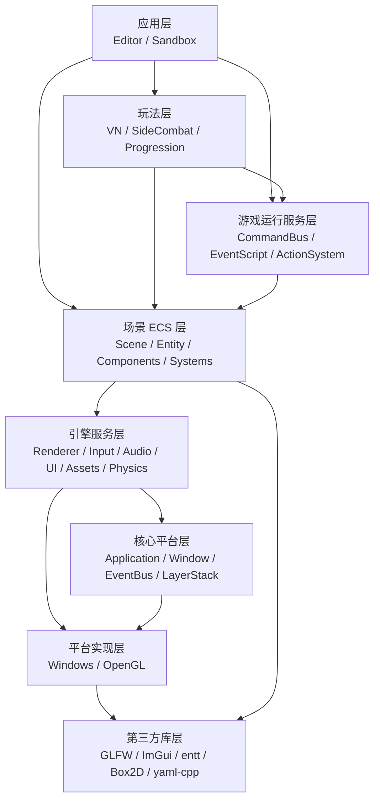

# 第 0 编 01：分层架构与学习目标

> 用途：这是 Wheatear 引擎教材的总纲。它面向两个场景：
> 一是作者本人复盘引擎源码，真正把代码变成自己的知识；
> 二是用于面试讲解和新人入门，让别人能快速理解这个项目为什么这样组织。

## 1.1 为什么先讲分层

阅读一个引擎项目时，最容易陷入的状态是“看到哪个文件就学哪个文件”。这样很快会迷路：`Application`、`Scene`、`Renderer2D`、`CommandBus`、`SideCombatSystem` 都很重要，但它们的重要性不是同一种重要性。

分层的作用，就是先回答三个问题：

- 这个模块属于引擎的哪一层？
- 它应该依赖谁，不应该依赖谁？
- 面试或新人学习时，应该先讲它的职责，还是先讲它的细节？

对 Wheatear 来说，这一点尤其重要。这个项目不是只为了展示渲染 Demo，而是为了做一些完整的 2D 平面游戏：有编辑器、有场景、有 UI、有动画、有输入、有脚本、有存档、有横板战斗和 VN 剧情流程。它的目标不是追求大型商业引擎的全功能，而是服务于轻量、可控、可打包的 2D 游戏制作。

因此，本学习路线不从某个炫技系统开始，而是先建立架构地图。

## 1.2 Wheatear 的推荐分层

Wheatear 可以按“从底层能力到最终游戏”的方向分成八层：

```text
应用层
Editor / Sandbox

玩法层
VN / SideCombat / TurnCombat / TacticalCombat / Arcade / Progression

游戏运行服务层
CommandBus / EventScript / ActionSystem / SceneTransition / GameProgress

场景 ECS 层
Scene / Entity / Components / Systems / SceneSerializer

引擎服务层
Renderer / Audio / Input / AssetPath / UI / Physics

核心平台层
Application / Window / EventBus / LayerStack / Log / Timestep

平台实现层
WindowsWindow / OpenGLContext / OpenGLRendererAPI / OpenGLTexture

第三方库层
GLFW / OpenGL / ImGui / entt / Box2D / yaml-cpp / stb
```

如果换成源码目录，大致对应如下：

| 架构层级 | 主要源码位置 | 主要职责 |
| --- | --- | --- |
| 应用层 | `WheatearEditor/src`、`WheatearSandbox/src` | 把引擎包装成编辑器或独立运行器 |
| 玩法层 | `Wheatear/src/Wheatear/Modules` | 实现具体玩法规则，如 VN、横板战斗、成长系统 |
| 游戏运行服务层 | `Runtime`、`Scripting`、`Gameplay/Action` | 串联命令、事件脚本、动作结算、切场景、存档 |
| 场景 ECS 层 | `Scene`、`Systems` | 管理实体、组件、系统生命周期和场景序列化 |
| 引擎服务层 | `Renderer`、`Input`、`Audio`、`UI`、`Assets` | 提供渲染、输入、音频、UI、资源解析等能力 |
| 核心平台层 | `Core` | 程序生命周期、主循环、Layer、事件总线、日志、时间步 |
| 平台实现层 | `Platform` | Windows、OpenGL 等平台和后端实现 |
| 第三方库层 | `vendor` | 外部依赖，由引擎封装后使用 |

可以用一张依赖图表示：



这张图不是说代码里每个 include 都严格符合箭头方向，而是说学习和维护时应该尽量按这个方向理解。

## 1.3 代表性 API 索引

分层学习不能只背目录。后续每一章都会尽量落到具体 API、调用链和源码位置上。第一章先列出后续会反复出现的核心 API，读源码时可以把它们当成路标。

| 架构层级 | 代表性 API / 类型 | 学习时要回答的问题 |
| --- | --- | --- |
| 应用层 | `CreateApplication()`、`EditorLayerBase::TransitionToPlay()`、`RuntimeSceneLayer::LoadScene()` | 具体程序如何选择启动编辑器、运行器或某个场景 |
| 玩法层 | `VisualNovelSystem::OnUpdateRuntime()`、`SideCombatSystem::OnUpdateRuntime()`、`ProgressionSystem::OnUpdateRuntime()` | 玩法模块如何接入 Scene，每帧如何推进自己的规则 |
| 游戏运行服务层 | `CommandBus::Execute()`、`CommandBus::DrainGameplayCommands()`、`SceneTransitionService::RequestLoadScene()`、`EventScriptSystem::OnUpdateRuntime()` | UI、脚本、剧情和玩法如何用命令解耦 |
| 场景 ECS 层 | `Scene::CreateEntity()`、`Scene::OnRuntimeStart()`、`Scene::OnUpdateRuntime()`、`Entity::AddComponent<T>()`、`SceneSerializer::DeserializeYaml()` | 游戏世界如何由实体、组件和系统组成 |
| 引擎服务层 | `Renderer2D::BeginScene()`、`Renderer2D::DrawSprite()`、`Renderer2D::EndScene()`、`InputBindingService::IsActionPressed()`、`AssetPath::ResolveRuntimeData()` | 通用能力如何被多个系统复用 |
| 核心平台层 | `Application::Run()`、`Application::PushLayer()`、`Application::FlushEventQueue()`、`Layer::OnUpdate()`、`EventBus::Subscribe()` | 程序如何启动、每帧如何调度、事件如何流动 |
| 平台实现层 | `Window::Create()`、`WindowsWindow::OnUpdate()`、`OpenGLContext::Init()`、`OpenGLRendererAPI::DrawIndexed()` | 引擎接口如何落到 Windows、GLFW、OpenGL |
| 第三方库层 | `glfwPollEvents()`、`entt::registry`、`b2World`、`YAML::Node`、`ImGui::Begin()` | 外部库承担了哪些基础能力，边界在哪里 |

例如后续讲 Core 层时，不会只说“Application 是主循环”，而是会具体看：

```cpp
Application::Run()
Application::PushLayer(std::unique_ptr<Layer> layer)
Application::PopLayer(Layer* layer)
Application::FlushEventQueue()
EventBus::Queue(const Event& event)
EventBus::Dispatch(Event& event)
```

讲 Scene 层时，也不会只说“用了 ECS”，而是会看：

```cpp
Scene::CreateEntity(const std::string& name)
Scene::CreateEntityWithUUID(UUID uuid, const std::string& name)
Entity::AddComponent<T>(Args&&... args)
Entity::GetComponent<T>()
Scene::OnRuntimeStart()
Scene::OnUpdateRuntime(Timestep ts)
SceneSerializer::SerializeYaml(const std::filesystem::path& filepath)
SceneSerializer::DeserializeYaml(const std::filesystem::path& filepath)
```

这样学习有一个好处：面试时能从架构讲到实现，新人学习时也能从概念找到代码，不会停在“我知道大概有一层叫 Scene”这种模糊理解。

## 1.4 一条端到端调用链示例

为了说明“分层不是空话”，可以先看一个典型流程：玩家点击 UI 按钮切换场景。

```text
UI 按钮被点击
    ↓
UIInputSystem 检测鼠标命中
    ↓
CommandBus::Execute(scene, "scene:assets/scenes/Hub.wt")
    ↓
SceneTransitionService::RequestLoadScene(...)
    ↓
RuntimeSceneLayer::ConsumeSceneTransitionRequests()
    ↓
RuntimeSceneLayer::LoadScene(...)
    ↓
SceneSerializer::DeserializeYaml(...)
    ↓
Scene::OnRuntimeStart()
    ↓
新场景的 Systems 开始运行
```

这条链路经过了多个层级：

| 步骤 | 所属层级 | 说明 |
| --- | --- | --- |
| UI 输入命中 | 引擎服务层 | UI 系统只负责判断交互，不直接知道 Sandbox 如何换场景 |
| 执行 `scene:` 命令 | 游戏运行服务层 | `CommandBus` 把短命令翻译为结构化请求 |
| 保存切场景请求 | 游戏运行服务层 | `SceneTransitionService` 只记录请求，不直接加载文件 |
| RuntimeSceneLayer 消费请求 | 应用层 | Sandbox 决定何时真正卸载旧场景、加载新场景 |
| 反序列化 `.wt` 文件 | 场景 ECS 层 | `SceneSerializer` 把 YAML 还原为实体和组件 |
| 启动系统 | 场景 ECS 层 | `Scene::OnRuntimeStart()` 注册并启动运行时系统 |

这就是这个引擎的典型设计：底层服务不直接控制上层应用，上层应用通过运行时服务拿到请求，再决定什么时候执行。

## 1.5 后续文档的写法约定

后续章节会采用同一种格式，方便面试复习和新人顺读：

```text
这一层解决什么问题
    ↓
核心类型和 API
    ↓
源码调用链
    ↓
为什么这样设计
    ↓
优点、代价和容易踩的坑
    ↓
面试可以怎么讲
    ↓
新人阅读建议和小练习
```

另外，每章都会固定配一个“具体且常见的例子”，比如：

- 启动编辑器时，`CreateApplication()` 为什么会返回 `WheatearEditor`。
- 点击一个按钮时，事件如何经过 `WindowsWindow -> Application -> EventBus -> Layer`。
- 在 Sandbox 里加载场景时，`RuntimeSceneLayer::LoadScene()` 为什么会先停旧场景再开新场景。

也就是说，它不是纯 API 手册，但会鼓励引用 API 和真实例子。API 用来证明架构不是口头描述，而真实例子用来说明“这个结果是怎么出来的”。

## 1.6 每一层解决什么问题

### 第三方库层

这一层提供成熟基础能力：

- GLFW：窗口、输入事件、OpenGL 上下文。
- OpenGL：实际图形 API。
- ImGui：编辑器 UI。
- entt：ECS 数据结构。
- Box2D：2D 物理。
- yaml-cpp：场景和数据表序列化。
- stb：图片加载等轻量工具。

这一层的重点不是深入研究库本身，而是看引擎如何封装它们。例如业务代码不应该到处直接调用 GLFW，而应该通过 `Window`、`Input`、`Event` 等引擎接口访问。

### 平台实现层

这一层把第三方库和平台 API 接入引擎：

- `WindowsWindow` 把 GLFW 窗口事件转换成 Wheatear 自己的事件类型。
- `OpenGLContext` 创建和管理 OpenGL 上下文。
- `OpenGLRendererAPI` 实现清屏、绘制、视口、混合、深度测试等底层渲染命令。
- `OpenGLTexture` 实现具体纹理上传和绑定。

它的价值是隔离后端。上层系统知道“我要画东西”，但不需要知道 OpenGL 的全部细节。

### 核心平台层

这一层让引擎“活起来”：

- `EntryPoint` 负责进入程序。
- `Application` 负责主循环。
- `LayerStack` 负责组织可插拔功能层。
- `EventBus` 负责事件分发。
- `Log`、`Timestep`、`Core` 提供全局基础设施。

这是学习源码的第一站。理解这一层后，就能知道每一帧到底是谁在驱动谁。

### 引擎服务层

这一层提供通用游戏能力：

- `Renderer2D` 和 `Renderer3D` 负责渲染。
- `Input` 和 `InputBindingService` 负责输入查询与动作映射。
- `AudioEngine` 负责音频。
- `AssetPath` 负责资源路径解析。
- `UISystem` 和 UI 组件负责运行时 UI。
- `PhysicsSystem` 负责 Box2D 与 ECS 的同步。

这些能力不属于某一个玩法，而是多个玩法共享的基础服务。

### 场景 ECS 层

这一层定义“游戏世界怎么组织”：

- `Scene` 拥有 entt registry。
- `Entity` 是对 entt handle 和 Scene 指针的轻量包装。
- `Components` 保存实体数据。
- `Systems` 每帧读取组件并执行逻辑。
- `SceneSerializer` 把场景保存为 `.wt`，也负责从 `.wt` 加载场景。

这一层是引擎的骨架。Wheatear 的 UI、动画、物理、渲染、玩法实体，最终都会落到 Scene/ECS 中。

### 游戏运行服务层

这一层负责把数据、脚本和玩法串起来：

- `CommandBus`：统一执行短命令，例如 `scene:...`、`event:...`、`vn:...`。
- `EventScriptSystem`：运行 `.wts` 事件脚本。
- `SceneTransitionService`：保存结构化切场景请求。
- `GameProgress`：保存玩家进度、存档、成长状态。
- `ActionSystem / WAO`：统一动作配方、效果、资源、冷却和结算记录。

这层的特点是“它不一定直接画东西，也不一定直接控制某个角色，但它决定流程如何推进”。

### 玩法层

这一层实现具体游戏类型：

- VN：对话、选项、剧情推进。
- SideCombat：横板战斗、技能、命中框、敌人 AI、HUD。
- TurnCombat：回合制战斗。
- TacticalCombat：战旗战斗。
- Arcade：轻量弹幕/假玩法。
- Progression：成长、据点、技能树、装备、关系、结算。

对这个项目来说，横板 2D 游戏和 VN/据点流程是最贴近目标的玩法层。其他玩法也存在，但可以把它们当作“模块化扩展示例”。

### 应用层

这一层把引擎变成真正可运行的软件：

- `WheatearEditor`：编辑器，负责场景编辑、资产浏览、Inspector、动画编辑、打包等。
- `WheatearSandbox`：独立运行器，负责加载项目场景或打包资源并播放完整流程。

这一层最适合面试时讲“我不是只写了一个库，而是把库包装成了编辑器和运行时”。

## 1.7 这样分层的好处

### 好处一：新人不会一上来就迷路

新人看到 `SideCombatHudService.cpp` 这种大文件，很容易以为它就是引擎核心。但按分层看，它只是玩法层的一个服务，依赖下方的 UI、Scene、CommandBus、Renderer2D。

有了分层后，新人可以先学：

```text
Application 怎么跑
Scene 怎么组织实体
System 怎么每帧更新
Renderer/Input/UI 怎么提供能力
玩法模块怎么复用这些能力
```

这比直接跳进具体玩法代码更稳。

### 好处二：面试表达更清楚

面试官问“你的引擎架构是什么样的？”时，不适合先讲某个函数细节。更好的回答方式是：

```text
这是一个面向 2D 游戏的轻量编辑器优先引擎。
底层用 GLFW/OpenGL/ImGui/entt/Box2D/yaml-cpp。
Core 层负责主循环、事件、Layer；
Scene 层负责 ECS 和系统生命周期；
Renderer/Input/Audio/UI/Physics 提供通用服务；
Runtime 层用 CommandBus、EventScript、SceneTransition 串流程；
Modules 层实现 VN、横板战斗、成长等玩法；
Editor 和 Sandbox 共用同一个运行时库。
```

这个回答先讲边界，再讲取舍，最后才能展开具体系统。

### 好处三：容易判断代码应该放哪里

新增功能时，可以用分层判断位置：

| 需求 | 应该放在哪里 |
| --- | --- |
| 新增一种实体数据 | `Scene/Components` 或模块组件 |
| 新增每帧通用能力 | `Systems` |
| 新增横板战斗独有行为 | `Modules/SideCombat` |
| 新增编辑器面板 | `WheatearEditor/src` |
| 新增运行时短命令 | `Runtime/CommandBus` 或对应模块命令处理 |
| 新增 OpenGL 实现细节 | `Platform/OpenGL` |

分层不是为了画图好看，而是为了减少“随手塞代码”的冲动。

### 好处四：适合简单 2D 游戏的生产方式

这个项目的目标是做简单但完整的 2D 平面游戏，不是做大型开放世界引擎。分层后的重点很明确：

- 2D 渲染要稳定、可合批。
- 场景要能保存、加载、复制和打包。
- UI、VN、横板战斗、成长流程要能数据驱动。
- 编辑器要能提升制作效率。
- Sandbox 要能脱离编辑器运行。

这套架构牺牲了一些大型引擎的通用性，换来更短的制作链路和更容易理解的源码。

## 1.8 这样分层的坏处和代价

### 代价一：分层不是完全纯净的

Wheatear 不是教科书式的纯分层架构。比如 `Scene` 会直接配置核心系统：

```text
Physics
Animation
SpriteSheet
Audio
UI
Render
```

同时，玩法系统又通过 `SceneSystemRegistry` 注册到运行时系统集中。

这说明它更偏实用型：为了让编辑器和 Sandbox 快速共享同一套运行逻辑，`Scene` 承担了比较强的调度职责。

好处是链路短、容易跑通；坏处是 `Scene` 的责任边界会变重。

### 代价二：全局服务会让依赖变隐蔽

`CommandBus`、`GameProgress`、`AssetPath`、ActionDatabase、各种 Registry 都带有全局状态。

这在小型 2D 项目中很实用，因为调用简单，跨 UI、脚本、玩法模块通信方便。但代价是：

- 调试时要知道命令从哪里入队、在哪里被消费。
- 单元测试不容易隔离。
- 多场景、多存档、多项目并行时要特别注意状态清理。

所以学习时不能只看函数调用，还要看“谁在持有全局状态”。

### 代价三：模块多了之后，源码入口会变散

玩法层已经包含 VN、横板、回合、战旗、Arcade、Progression。模块化带来的好处是边界清楚，但新人阅读时会有一个问题：同样是战斗，为什么有好几个系统？

解决方式是按目标学习：

- 如果目标是理解引擎骨架，先不要深入所有玩法模块。
- 如果目标是做当前 2D 横板游戏，优先看 `SideCombat` 和 `Progression`。
- 如果目标是面试讲架构，可以把其他玩法作为“模块扩展能力”的例子。

### 代价四：编辑器和运行时共用代码，需要区分模式

编辑器和 Sandbox 共用同一个引擎静态库，这是优点；但也意味着很多系统要同时考虑编辑模式和运行模式。

例如编辑器点击 Play 时，不是直接在编辑场景上运行，而是复制出一个运行时场景副本。这样可以避免运行时改动污染编辑场景，但也要求开发者理解：

```text
Editor Scene：编辑用，保存到磁盘
Play Scene：运行用，停止时丢弃
Runtime Scene：Sandbox 中实际加载的场景
```

如果不理解这个区别，就容易误判“为什么我运行时改了组件，停止后没有保存”。

## 1.9 和常见引擎架构的对比

### 和 Unity 的相似点与不同点

相似点：

- 都是编辑器优先。
- 都围绕场景、实体对象和组件组织游戏内容。
- 都强调资源、Prefab、Inspector、运行时预览。

不同点：

- Unity 的用户脚本和引擎运行时边界更成熟，Wheatear 目前主要是 C++ 模块和数据脚本。
- Unity 的生态更完整，Wheatear 的目标更小：服务自己的 2D 游戏制作链路。
- Wheatear 的源码完全可控，学习价值更直接；但工具链、导入器、调试器和跨平台能力远不如成熟商业引擎。

面试表达时可以说：Wheatear 借鉴了“编辑器 + 场景 + 组件 + Prefab”的工作流，但实现规模更轻，重点是理解引擎链路和 2D 游戏生产。

### 和 Unreal Engine 的相似点与不同点

相似点：

- 都有模块化思想。
- 都有编辑器和运行时分离的意识。
- 都强调数据驱动和工具化。

不同点：

- Unreal 的 Gameplay Framework、反射、蓝图、资源系统、渲染管线非常庞大；Wheatear 没有追求这个规模。
- Wheatear 的玩法模块更像“编译进引擎的轻量插件”，而不是完整的引擎插件生态。
- Unreal 更适合大型团队和复杂项目；Wheatear 更适合个人或小团队理解、控制并完成 2D 竖切游戏。

面试时不要硬说“我做了一个小 Unreal”。更准确的说法是：我在小规模项目里实践了模块化、编辑器工具、场景系统、数据驱动和运行时分层。

### 和 Godot 的相似点与不同点

相似点：

- 都适合 2D 游戏。
- 都重视场景和节点/实体组织。
- 都强调轻量、快速迭代和编辑器工作流。

不同点：

- Godot 的核心抽象是 Node/Scene Tree；Wheatear 的核心抽象是 ECS Scene。
- Godot 的脚本语言和编辑器生态成熟；Wheatear 的脚本更偏事件编排，复杂逻辑仍主要在 C++ 模块中。
- Wheatear 更适合作为源码学习项目，因为系统边界更小，能从 `main()` 一路读到玩法模块。

### 和学习型引擎 Hazel 的相似点与不同点

相似点：

- 都有 `Application`、`Layer`、`Event`、`Renderer2D`、Scene/ECS 等典型教学型引擎结构。
- 都适合从底层一步步理解现代轻量引擎。

不同点：

- Wheatear 已经加上了更多“做游戏需要的东西”：编辑器面板、UI、事件脚本、存档、玩法模块、打包。
- Hazel 更像引擎技术教学路线；Wheatear 更像在教学型架构上继续长出来的 2D 游戏制作工具链。

所以 Wheatear 的学习重点不是“这个模式是不是原创”，而是“我能不能讲清楚这些模式如何组合成一个能做游戏的项目”。

## 1.10 为什么这个分层适合简单 2D 游戏

简单 2D 游戏并不等于系统简单。一个能发布的 2D 游戏通常也需要：

- 场景切换。
- UI 流程。
- 输入映射。
- 动画和图集。
- 物理或碰撞。
- 存档。
- 结算。
- 资源打包。
- 编辑器或至少半自动内容生产工具。

Wheatear 的价值在于，它没有把这些功能都塞进一个巨大的 `Game.cpp`，而是拆成几层：

```text
底层负责跑起来
Scene 负责组织世界
System 负责每帧执行
Runtime 服务负责流程串联
Module 负责具体玩法
Editor 负责生产内容
Sandbox 负责独立运行
```

这对 2D 游戏很合适，因为 2D 项目的最大风险往往不是“渲染技术不够先进”，而是流程、资产、UI、战斗、存档和编辑工具缠在一起，最后谁也不敢改。

## 1.11 学习路线

后续文档就按这个分层往上学：

| 章节 | 学习层级 | 核心问题 |
| --- | --- | --- |
| 01 | 分层架构与学习目标 | 这个引擎怎么分层，为什么这样分 |
| 02 | Core 层 | 程序如何启动，主循环如何驱动 Layer |
| 03 | Event 与 Input | 操作系统事件如何进入引擎，输入状态如何查询 |
| 04 | Scene 与 Entity | ECS 如何组织游戏世界 |
| 05 | Component 与 Serializer | 数据如何保存、加载、复制 |
| 06 | System 生命周期 | 编辑模式和运行模式如何切换 |
| 07 | Renderer2D | 2D 精灵、UI、文本如何合批渲染 |
| 08 | Asset 与 SpriteSheet | 资源路径、图集、动画帧如何解析 |
| 09 | UI 系统 | 运行时 UI 如何布局、输入和绘制 |
| 10 | Physics 与 Animation | 动画、碰撞和 Box2D 如何配合 |
| 11 | CommandBus 与 EventScript | 按钮、剧情、切场景如何串起来 |
| 12 | WAO ActionSystem | 技能、效果、资源、冷却如何统一结算 |
| 13 | VN 与 Progression | 剧情、据点、成长、存档如何形成流程 |
| 14 | SideCombat | 横板战斗如何拆成系统和服务 |
| 15 | Editor | 编辑器如何复用运行时引擎 |
| 16 | Sandbox 与打包 | 项目如何脱离编辑器独立运行 |

这条路线同时服务两个目标：

- 对新人：按顺序读，能从底层逐步建立完整理解。
- 对面试：每章都能整理成一个可讲述的项目亮点。

## 1.12 面试时如何概括这一章

可以准备一个短版本：

```text
Wheatear 是一个面向 2D 游戏的轻量编辑器优先引擎。
它采用分层架构：底层封装 GLFW、OpenGL、ImGui、entt、Box2D；
Core 层负责主循环、事件和 Layer；
Scene/ECS 层负责实体、组件、系统和序列化；
Renderer、Input、Audio、UI、Physics 提供通用引擎服务；
Runtime 层用 CommandBus、EventScript、SceneTransition 和 GameProgress 串联游戏流程；
玩法模块层实现 VN、横板战斗、成长等具体功能；
最上层是 Editor 和 Sandbox，共用同一个引擎静态库。

这样做的好处是新人容易理解、模块边界较清楚、编辑器和运行时能复用代码；
代价是分层并不完全纯净，Scene 和全局服务承担了较多调度职责。
这个取舍适合个人或小团队制作简单但完整的 2D 游戏。
```

也可以准备一个更工程化的版本：

```text
我的重点不是做一个大而全的商业引擎，而是在一个可控规模内实践完整游戏引擎链路：
应用启动、事件、输入、ECS、渲染、资源、脚本、玩法模块、编辑器和打包。
Wheatear 的架构偏实用型分层，核心目标是支撑 2D 游戏内容生产和运行时闭环。
```

## 1.13 本章小结

本章先不深入具体代码，而是确定学习视角：

- Wheatear 可以按八层理解：第三方库、平台实现、Core、引擎服务、Scene/ECS、Runtime 服务、玩法模块、应用层。
- 它不是完全纯净的分层架构，而是分层、ECS、模块注册和数据驱动的混合架构。
- 这种设计很适合学习源码、面试表达和 2D 游戏竖切制作。
- 后续章节会从 Core 层开始，逐层向上读源码。

正式自底向上阅读时，下一编先补第三方与平台层；如果按已经写好的正文继续读，可以进入 Core 层：从 `main()`、`CreateApplication()`、`Application::Run()`、`LayerStack` 和 `EventBus` 开始，看引擎是如何真正跑起来的。
